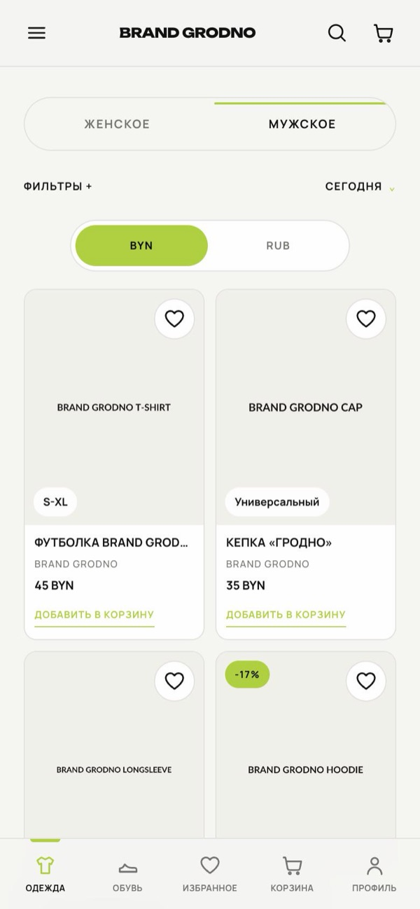
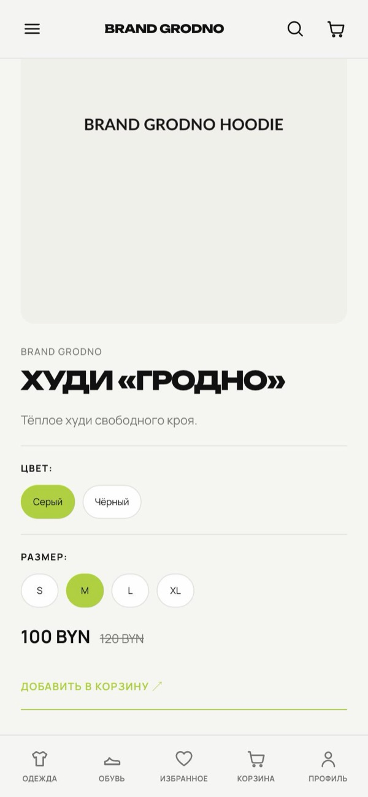
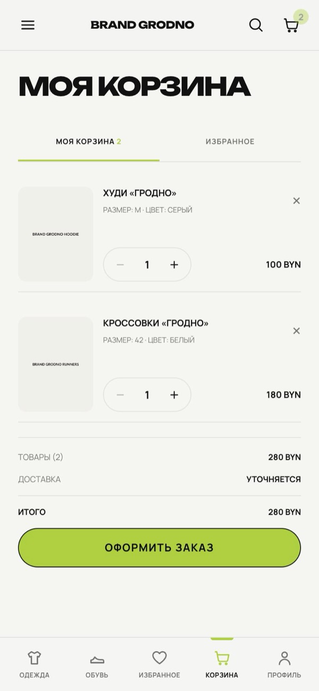
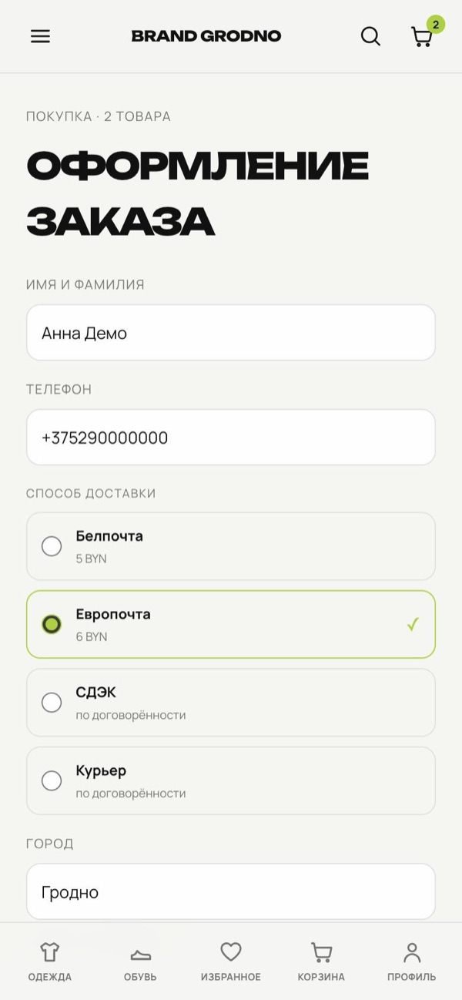
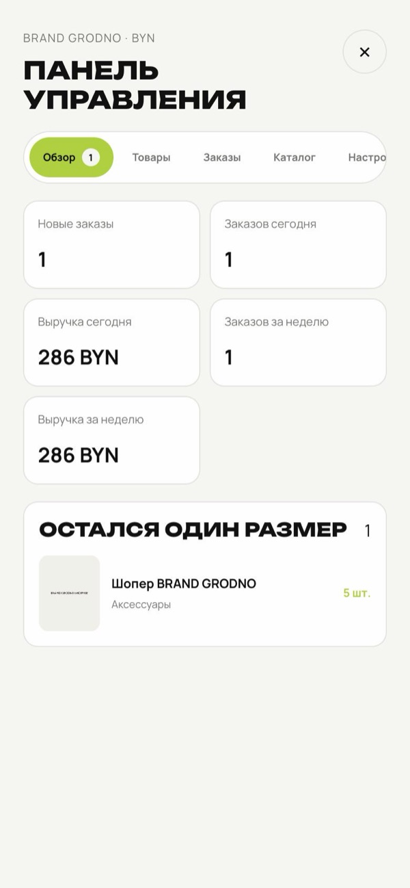
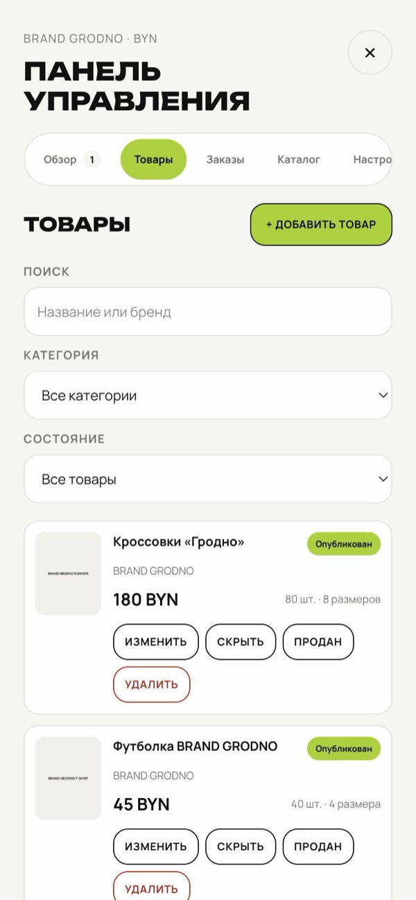
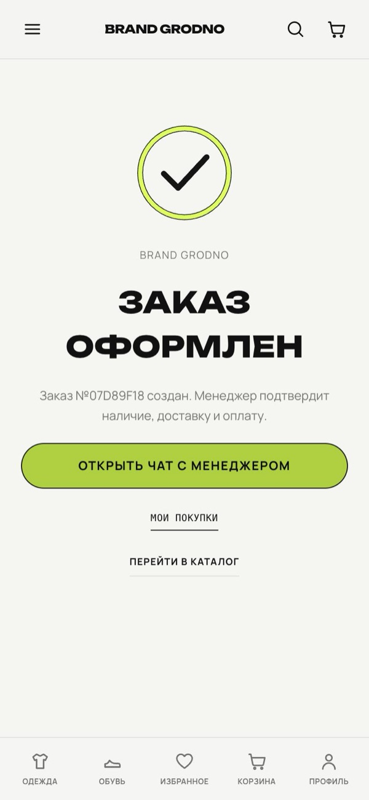
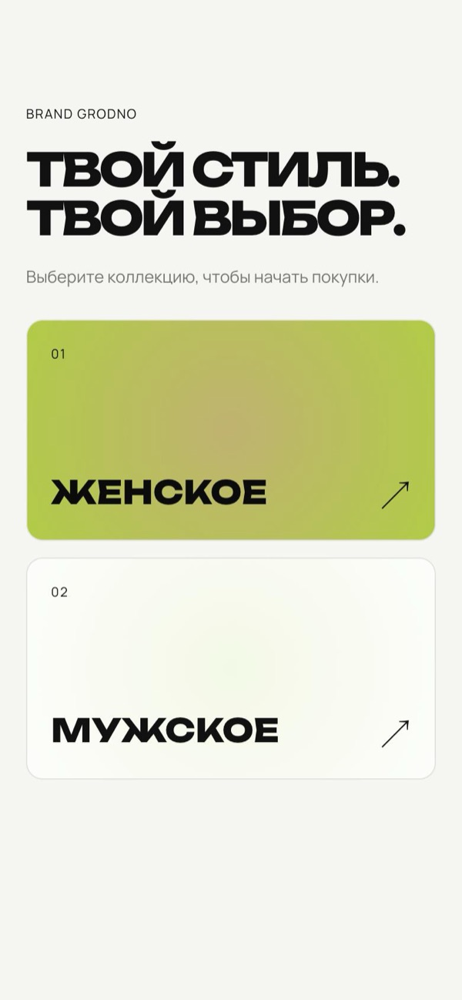

<div align="center">

# 🛍️ BRAND GRODNO — Telegram Mini App Store

**A complete online store inside Telegram — catalog, cart, orders, admin panel and a bot for managers.**

<a href="https://github.com/Marcountt/telegram-shop-miniapp/actions/workflows/ci.yml"></a>
<br/>


</div>

---

## 💡 What it does

Customers open the store with one tap from the bot, browse products, pick a size, place an order and continue the conversation with a manager — without leaving Telegram.
The store owner manages products, photos, prices, stock and orders from an admin panel inside the same Mini App.

> Built for **BRAND GRODNO** — a clothing, shoes and accessories store in Grodno. The catalog in this repository is seed data with placeholder products.

## 📸 Screenshots

**Customer side** — catalog, product with colour and size, cart, checkout

<p align="center">
  
  
  
  
</p>

**Store owner** — dashboard, product management, order confirmation

<p align="center">
  
  
  
  
</p>

<sub>Screenshots from a local run with seed data; product photos are placeholders.</sub>

## ✨ Features

### For customers
- Clothing and shoes catalog with search, filters (category, size, price, availability, discounts) and sorting
- Infinite scroll, product pages with photo galleries, sizes and stock
- Favorites and a cart with stock checks on every change
- Checkout with delivery options (postal services, CDEK, courier) and delivery prices
- Order history and status updates in the bot
- Prices in two currencies with a configurable exchange rate
- Native Telegram feel: theme, BackButton, MainButton and haptic feedback

### For the store owner
- Admin panel inside the Mini App, available only to approved Telegram IDs
- Create, edit, hide and delete products, sizes and stock
- Upload several photos per product — automatically converted to WebP with thumbnails
- Manage categories, sizes, delivery methods, store texts and the exchange rate
- Order list with filters and status changes: confirm, shipped, delivered, cancel

### Telegram bot
- `/start` opens the store, with welcome text and ordering steps from the store settings
- New-order notifications for the manager, with buttons to change the order status
- `/orders` shows the customer's latest orders

## 🔒 Reliability and security

- Every protected request is authorized by **validating Telegram `initData` (HMAC) on the backend**
- Admin access is checked on the backend by Telegram ID
- **Stock is reserved with row locks inside a transaction**, so two customers cannot buy the last item
- Notifications use a **transactional outbox** with retries, so messages are not lost or sent twice
- Database changes are versioned with Alembic migrations
- Backend covered by automated tests (pytest)

## 🛠️ Tech stack

| Part | Technologies |
|---|---|
| Backend | Python, FastAPI, SQLAlchemy 2 (async), Alembic, Pydantic |
| Bot | aiogram 3 |
| Frontend | React, TypeScript, Vite, React Router, TanStack Query, Framer Motion, Tailwind CSS |
| Database | PostgreSQL in production, SQLite for local development |
| Deployment | Docker Compose, Caddy with automatic HTTPS, nginx |

## 🏗️ Architecture

```text
Telegram ──► Mini App (React) ──► FastAPI API ──► PostgreSQL
   ▲                                   │
   └──────── aiogram bot ◄── notification outbox
```

```text
backend/    FastAPI app, bot, database models, migrations, tests
frontend/   React Mini App
docs/       Detailed setup guide (in Russian)
```

## 🚀 Quick start

```bash
cp .env.example .env      # add your bot token from @BotFather and settings
docker compose up -d --build
```

The detailed guide — local run on a Mac, deployment to a VPS, backups and troubleshooting — is in [docs/SETUP.ru.md](docs/SETUP.ru.md).

---

<div align="center">

**Need a store or a bot like this for your business?**

<a href="https://t.me/Macount"></a>
<a href="mailto:marcountt@gmail.com"></a>

© 2026 Mark. All rights reserved. The code is published for portfolio review only.

</div>
